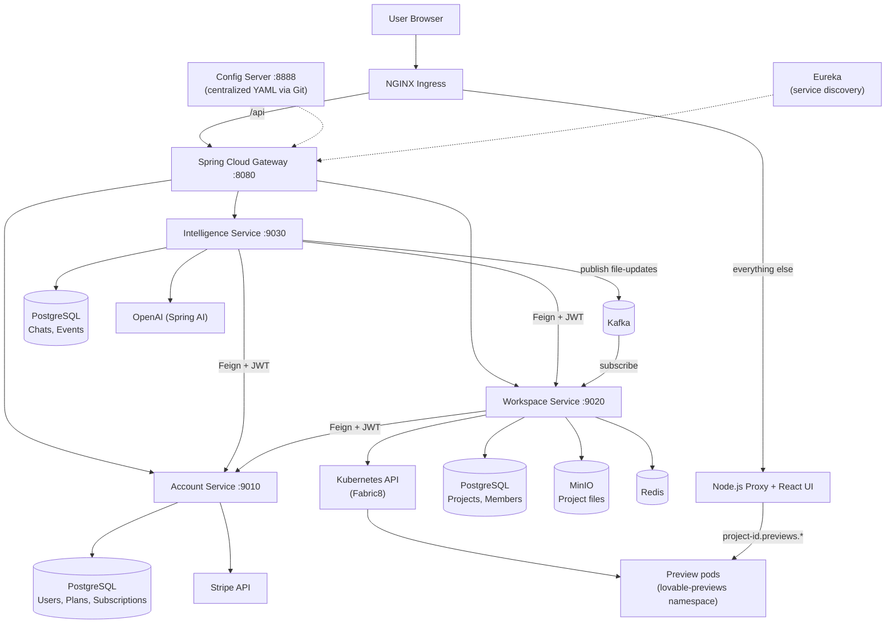
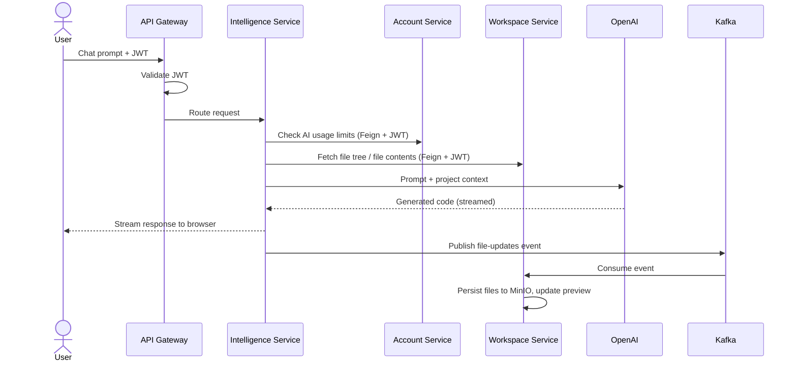

<div align="center">

# ⚡ Code Craft

### An AI app builder: describe an app in plain English, get a live React project

A distributed, multi-tenant SaaS platform built with **Spring Boot microservices**, **Spring AI**, and **Kubernetes**.


</div>

---

## 📖 Overview

**Code Craft** lets a user describe an application in natural language. An AI agent generates the full React project, stores the files, and spins up an isolated live preview environment, so the user can see the running app right away.

The backend is split into three Spring Boot microservices behind a Spring Cloud Gateway, with service discovery, centralized configuration, event-driven file updates over Kafka, and dynamic preview environments created on Kubernetes at runtime.

## ✨ Features

- **AI code generation** – natural-language prompts turned into complete React applications using Spring AI and OpenAI
- **Context-aware prompts** – the project's current file tree is injected into every prompt, and the LLM can read specific files through tool calling
- **Real-time streaming** – AI responses stream to the browser token by token (SSE)
- **Live previews** – every project gets its own preview pod, created dynamically with the Fabric8 Kubernetes client in an isolated namespace
- **Multi-tenant SaaS** – user accounts, project membership, and per-user project and AI usage limits
- **Subscription billing** – Free and Pro plans with Stripe integration
- **Layered security** – JWT validated at the gateway and re-validated inside every service
- **Event-driven file sync** – file updates are published to Kafka and consumed by the Workspace service

---

## 🏗️ Architecture

### System overview



### AI chat request flow



---

## 🧩 Microservices

| Service | Port | Responsibility | Storage | Integrations | Calls (Feign) |
|---|---|---|---|---|---|
| **Account Service** | 9010 | User identity, authentication, Stripe billing | PostgreSQL (users, plans, subscriptions) | Stripe API | None |
| **Workspace Service** | 9020 | Project management, file tree, Kubernetes deployments | PostgreSQL (projects, members), MinIO (files) | Kubernetes API, Redis | Account Service (check limits, users) |
| **Intelligence Service** | 9030 | AI chat, context gathering, code generation | PostgreSQL (chat sessions, messages, events) | OpenAI (Spring AI), Kafka | Workspace Service (read files), Account Service (check AI limits) |
| **API Gateway** | 8080 | Single entry point, routing, JWT validation, CORS | – | Eureka | – |
| **Config Server** | 8888 | Centralized configuration served from Git | – | – | – |

### Account Service

Handles user identity, authentication, and billing. It manages Free and Pro plans and subscriptions, processes Stripe payments and webhooks, and provides internal APIs so other services can look up users and verify billing plans. Payment handling is abstracted so providers can be swapped.

### Workspace Service

Manages projects, project members, and the project file tree. It stores generated files in MinIO, creates and tears down isolated preview environments on Kubernetes, and enforces project-level permissions so only authorized members can edit a project. It checks plan limits with the Account Service when users create projects.

### Intelligence Service

Powers the AI chat and code generation. It gathers project context (file tree and file contents) from the Workspace Service, builds the prompt, calls OpenAI through Spring AI, and streams the response back to the user. Generated files are parsed out of the model's output, chat history and usage are recorded, and file updates are published to Kafka. Daily AI limits are verified with the Account Service.

### Common Lib

A shared library used by every service:

- **JWT authentication logic**, so each service can verify tokens on its own
- **Automatic token forwarding** on service-to-service calls, so downstream services see the logged-in user
- **Shared DTOs**, so persistence entities never leak across service boundaries
- **Shared exceptions and enums** for consistent behavior across services

---

## 🔐 Security

Authentication happens at two layers (defense in depth):

1. **API Gateway** – rejects requests without a valid, signed, unexpired JWT before they reach any service. A configurable list of public routes (login, Stripe webhook) skips the check.
2. **Each microservice** – verifies the token again using the shared library and builds the user identity for that request. Nothing is trusted just because it came from inside the cluster.

Service-to-service calls forward the original JWT, so downstream services see the same logged-in user.

Authorization is resource-based: for example, the Workspace Service checks project membership before allowing edits.

---

## 🛠️ Tech Stack

| Layer | Technology |
|---|---|
| Language / Framework | Java, Spring Boot |
| Microservices | Spring Cloud Gateway, Eureka, Config Server, OpenFeign |
| AI | Spring AI, OpenAI |
| Messaging | Apache Kafka (topic: `file-updates`) |
| Databases | PostgreSQL (one per service), Redis |
| Object storage | MinIO  |
| Payments | Stripe |
| Orchestration | Kubernetes, Fabric8 Kubernetes client |
| Containers | Docker |
| Frontend | React, Node.js proxy |

---

## 📁 Project Structure

```
code-craft/
├── api-gateway/            # Spring Cloud Gateway (routing, JWT filter, CORS)
├── account-service/        # Users, auth, plans, Stripe billing
├── workspace-service/      # Projects, files, K8s preview management
├── intelligence-service/   # AI chat and code generation
└── common-lib/             # Shared security, DTOs, exceptions, enums
```

---

</div>
